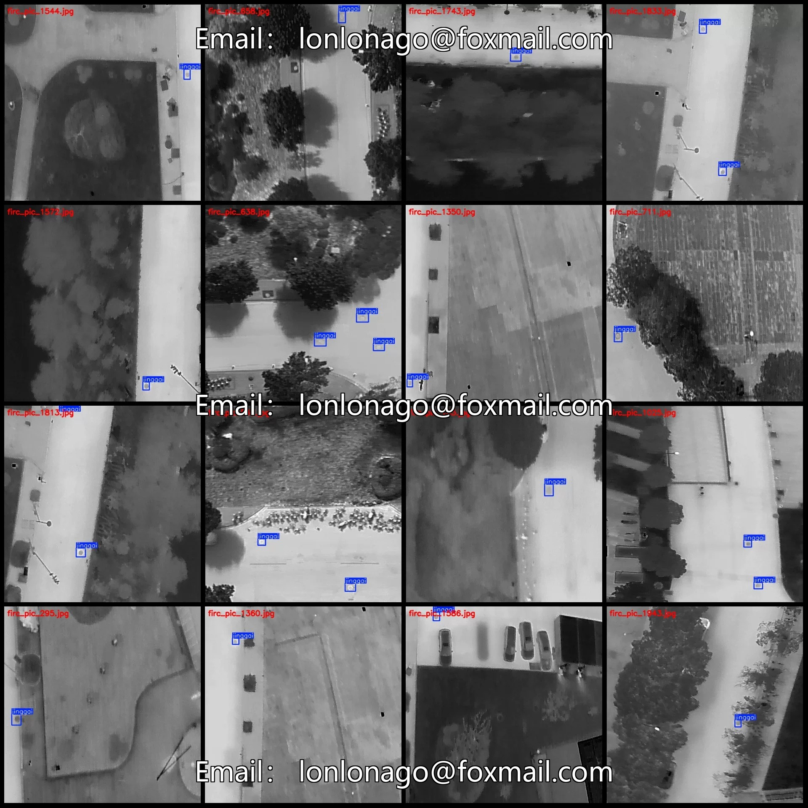
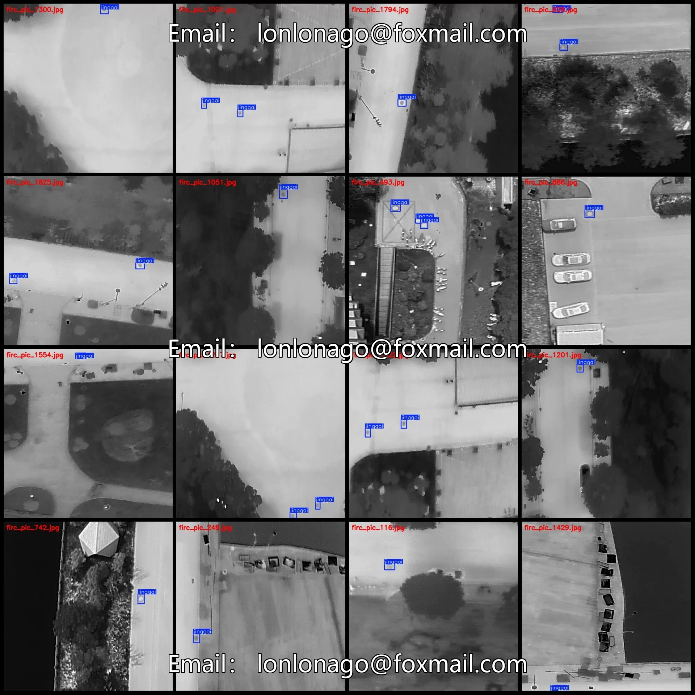
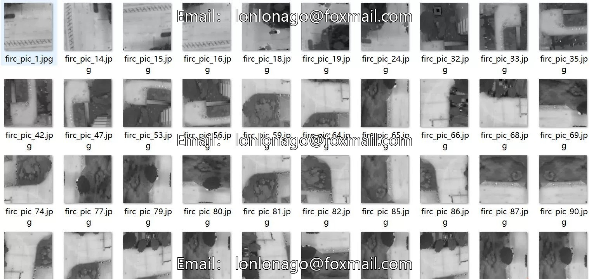
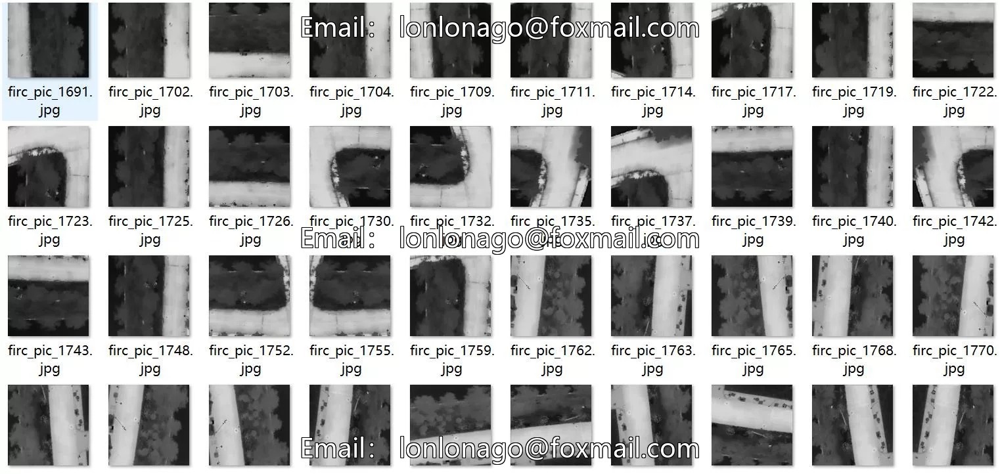

# UAV-view thermal imaging dataset for city street utility covers, VOC+YOLO format 1

## Body

Drone-View Thermal Infrared City Street Sewer Cover Detection Dataset VOC+YOLO Format: 1021 Images, 1 Category
Warm Reminder: Due to the dataset's replicability, please confirm compliance with requirements before purchasing.
This is merely for detecting sewer covers, not for detecting defects in them.
Dataset format: Pascal VOC format + YOLO format (excluding the segmentation path in the txt file, only including jpg images and corresponding VOC format xml files and yolo format txt files.)
Number of images (number of jpg files): 1021
Number of annotations (number of xml files): 1021
Number of annotations (number of txt files): 1021
Number of annotation categories: 1

Label category name: ["jinggai"]
Number of boxes labeled in each category
Jinggai frame count = 1587
Total frame count: 1587
Number of images per category
Jinggai's possession of images = 1021
Image resolution: 640x640
Using labelImg:
Annotation rules: Draw a rectangle around the category.
Important Notice: The dataset does not have separate training, validation, and test sets; you need to partition them yourself.
Special : This dataset does not guarantee the accuracy of the trained models or weight files.

## Images

## Payment

Here is a pay link on Stripe ( https://buy.stripe.com/3cs8yP7sY87d0vu9AB ). Please contact me lonlonago@foxmail.com after funding $89, and I will send you a complete data files , thank you!

